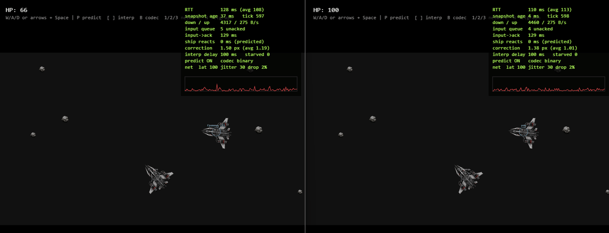
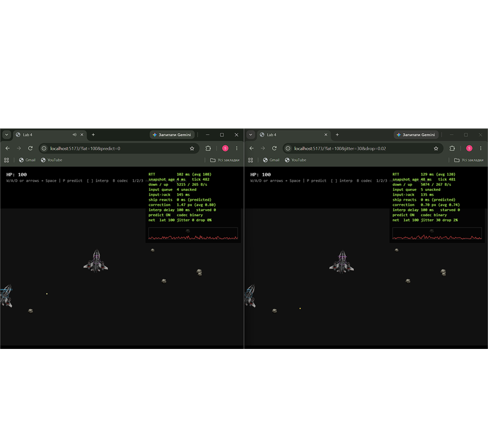
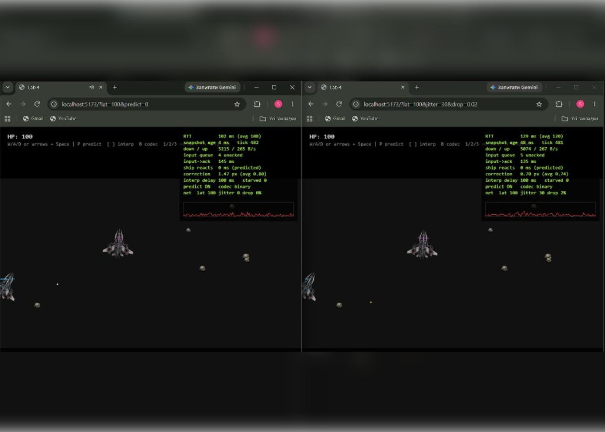

# Lab 5: авторитетний сервер, передбачення, інтерполяція, бінарний протокол

> **Демонстрація двох гравців у реальному часі:** робота авторитетного сервера з передбаченням свого корабля, інтерполяцією супротивника та штучною затримкою/розкидом (`?lat=100&jitter=30&drop=0.02`):
>
> 


## Як це влаштовано

```
shared/   чиста симуляція (sim.js), seed-генератор (rng.js), протокол (codec.js) — без DOM і без модулів Node
server/   Match на кімнату: 30 тіків/с, setTimeout на абсолютний цільовий час, валідація input, LinkSim (штучна мережа)
client/   Predictor (передбачення + звірка), Interpolator, NetStats, NetGame (цикл, малювання, netgraph)
```

- **Клієнт надсилає лише input** `{seq, thrust, turn, fire}`. Координат у протоколі немає, тому «телепорт» через DevTools неможливий. `sanitizeInput` відкидає (а не обрізає) `turn: 1000`; є ліміт частоти (token bucket) і максимум 8 input у черзі.
- **Один input = один крок.** Якщо input не встиг, корабель цього тіка стоїть (`starved`), якщо накопичилось — береться по одному за тік. Завдяки цьому клієнт може точно програти непідтверджені input.
- **Знімок** містить `tick` і `ack` (останній застосований `seq` саме цього клієнта).
- **Своя куля** з'являється одразу (id `-seq`) і живе локально; коли сервер підтвердив `seq`, а його кулі вже нема (влучила/вичерпала ttl) — локальна зникає. Чужі кулі інтерполюються.
- Симуляція нова (не перенесена 1:1): кораблі, кулі, астероїди, зіткнення, респавн. Підбирання (`Pickup`) зі старого клієнта не переносив.
- Старі `World/Ship/Bullet/Entity/Asteroid/Particle/Pickup/Vector2/components/physics` з `client/src` видалено — їх замінив `shared/src/sim.js`.

### Бінарний формат (версія 1, little-endian)

Повна специфікація — коментар на початку [`shared/src/codec.js`](shared/src/codec.js). Коротко:
`u8 версія, u8 тип`; input — 8 байт (`u32 seq`, `u8 прапорці`, `i8 turn`); знімок — 15 байт заголовка (`u32 tick`, `u32 ack`, лічильники) + кораблі по 25 Б, кулі по 20 Б, астероїди по 13 Б. Кут — `Int16` у 1/10000 рад (точність 0.0057°). JSON лишається для порівняння (`?codec=json`). Службові повідомлення (`join`, `welcome`, `ping`…) завжди JSON.

## Вимірювання

JSON проти бінарного, 30 Гц, 4 гравці (4 кораблі, 12 куль, 3 астероїди), `node shared/test/bench.mjs` (Node 26, мій ПК):

| Codec | Байт/знімок | КБ/с на клієнта (вниз) | Байт/input | КБ/с на клієнта (вгору) | Encode+decode, µс |
|---|---|---|---|---|---|
| JSON | 1832 | 53.67 | 59 | 1.73 | 9.2 |
| Binary (`DataView`) | 394 | 11.54 | 8 | 0.23 | 2.3 |

Бінарний знімок у 4.6 раза менший, input — у 7.4 раза; кодування+декодування швидше у ~4 рази.

Розбіжність передбаченого стану зі станом сервера (поправка при знімку, px), `node shared/test/experiment.mjs` — **симульована** мережа в процесі (справжні `shared`, codec і `Predictor`, віртуальний годинник), 30 с, 2 гравці:

| Умови | Середня | p95 | Макс |
|---|---|---|---|
| RTT 0 | 0 | 0 | 0 |
| RTT 100 | 0 | 0 | 0 |
| RTT 200 | 0 | 0 | 0 |
| RTT 100 ±30, 2 % втрат | 0.04 | 0 | 5.7 |

Без втрат поправка нульова навіть при RTT 200 (кут у `Int16` дає <0.001 px). Відхилення з'являються, коли input губиться (сервер не зробив крок, який клієнт уже передбачив) або запізнюється (крок пропущено) — ці 5–6 px згладжуються за ~100 мс.

## Запис на сторінку: netcode

**Три проблеми.**
1. *Затримка.* Без передбачення корабель рухається лише через RTT після натискання (при 100 мс це відчутно як «ковзання по милу»). Свій корабель тепер рухається одразу тим самим `integrate`, що й на сервері; знімок лише виправляє його.
2. *Узгодженість.* Світ рахує тільки сервер, усі бачать один стан; клієнт звіряється зі знімком: ставить корабель у стан сервера, відкидає `seq ≤ ack` і заново програє решту input. Поправку не показуємо стрибком, а розтікаємо експоненційно (≈95 % за 100 мс).
3. *Чіти.* Клієнт не може сказати серверу, де він; невалідний input відхиляється, частота обмежена, постріл/кулдаун/урон рахує сервер.

**Затримка до/після передбачення.** Netgraph: у режимі `?predict=0` (клавіша `P`) при `lat=100` корабель реагує лише після отримання підтвердженого знімка від сервера (`ship reacts after ~157 ms`), а при увімкненому передбаченні — реакція миттєва (`ship reacts: 0 ms (predicted)`), хоча час підтвердження сервером `input->ack` лишається тим самим (~157 мс).



**Баг із детермінізмом (навмисний).** У `integrate` додав `next.vx += (Math.random() - 0.5) * 400 * dt` (клієнт і сервер витягують різні числа), через що передбачений стан розходиться з авторитетним, і клієнту доводиться постійно підправляти корабель (`correction` підскакує до 1–2 px, а графік починає стрибати):



Таблиця результатів розбіжності за симуляцією `experiment.mjs`:

| Умови | Середня поправка, px (було → стало) | Макс, px |
|---|---|---|
| RTT 0 | 0 → 0.32 | 1.1 |
| RTT 100 | 0 → 0.73 | 2.7 |
| RTT 200 | 0 → 1.58 | 6.3 |
| RTT 100 ±30, 2 % | 0.04 → 1.12 | 311 |

Висновок: поправка росте разом із кількістю input, які треба програти (тобто із затримкою), а `simSelfTest()` двічі дає різні хеші (`366322189` ≠ `2351585862`). Після відкату хеш знову стабільний (`npm test` перевіряє це і ще те, що в `shared/src` нема `Math.random`/`Date.now`/DOM). Це симуляція, а не запис у браузері — скріншот netgraph з цим експериментом додати вручну.

**Затримка інтерполяції: 100 мс.** Інтервал знімків — 33 мс. Два інтервали (66 мс) вистачає, поки jitter малий, але при ±30 мс і втраті 2 % знімка може не бути на потрібний момент, і чужий корабель завмирає (`starved` у netgraph росте). Три інтервали (100 мс) дають запас на один втрачений знімок плюс розкид; більше — чужі кораблі надто «в минулому» (по них стріляєш туди, де їх уже немає, а лаг-компенсації тут нема). Значення 100 мс змінюється клавішами `[` `]`, підібране за netgraph при `lat=100&jitter=30&drop=0.02`; на реальній мережі не перевірялось.

**Таймер сервера.** `setTimeout` на `nextTick += 33.33` замість `setInterval`; при відставанні >5 тіків — ресинхронізація (`overruns`). На Windows `setTimeout` має зерно ~15 мс: у пробному запуску `jitterMsAvg ≈ 7 мс`, `max ≈ 15 мс`, `tickMsAvg ≈ 0.14 мс`. Цільовий час не зсувається, тож середня частота лишається 30 Гц.


---

